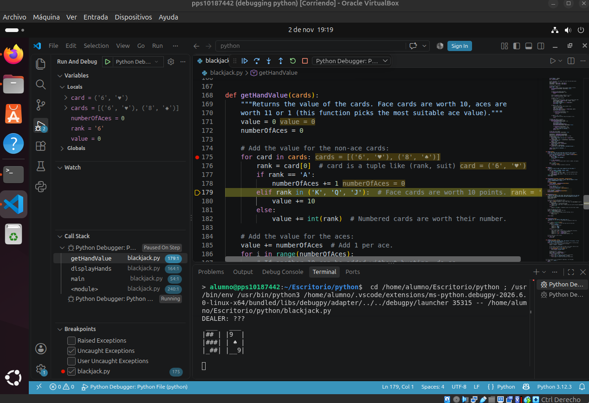

# Actividad 2: Ejecución y Pruebas de Aplicaciones en Python

## 1. Descripción del Programa
El programa consiste en una versión en consola del juego de cartas **Blackjack (21)** desarrollada en Python. Permite a un jugador apostar, pedir cartas (*Hit*), plantarse (*Stand*) o doblar la apuesta (*Double down*).

La lógica principal de cálculo de puntuación reside en la función `getHandValue(cards)`, la cual evalúa el valor total de la mano de un jugador o del crupier y ajusta de forma dinámica el valor de los Ases (1 u 11 puntos) para evitar superar los 21 puntos.


## 2. Ejecución del Programa

Para iniciar el juego desde la terminal de comandos:

```bash

python3 blackjack.py

```



# Actividad 2: Ejecución y Pruebas de Aplicaciones en Go

## 1. Descripción del Programa

## 2. Ejecución del Programa

