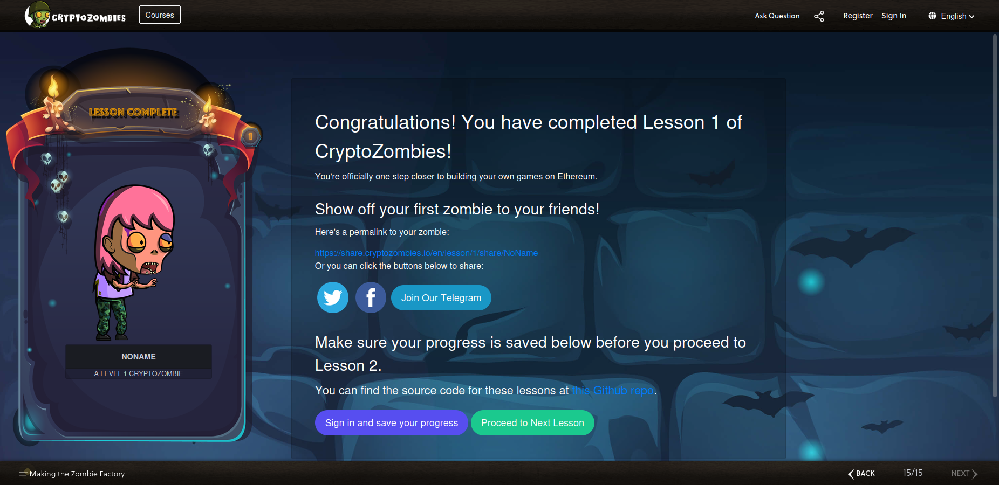
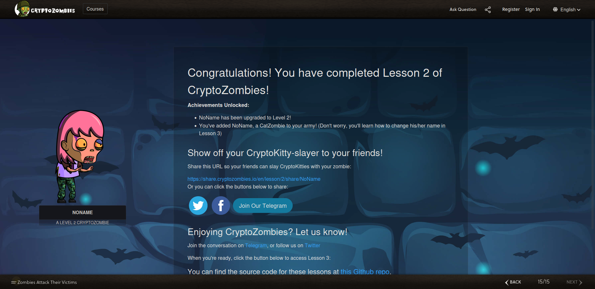
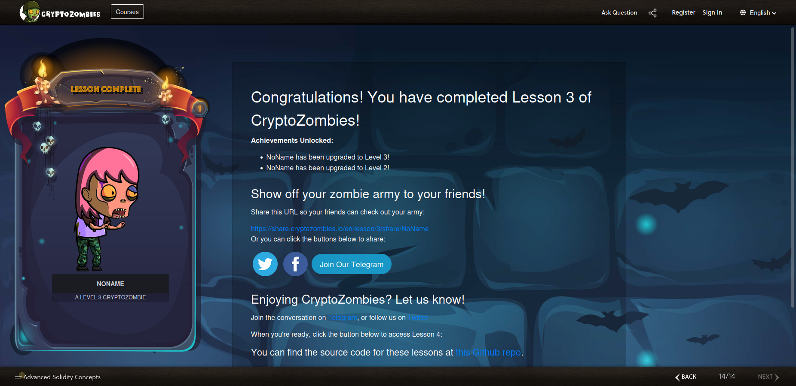
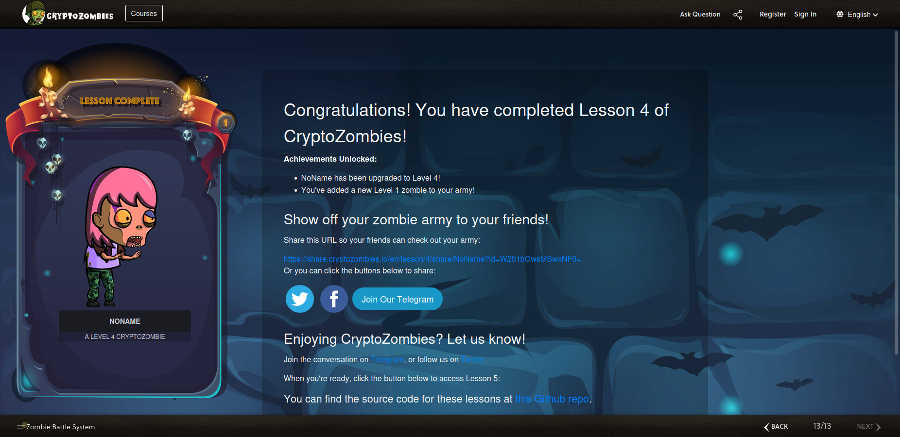
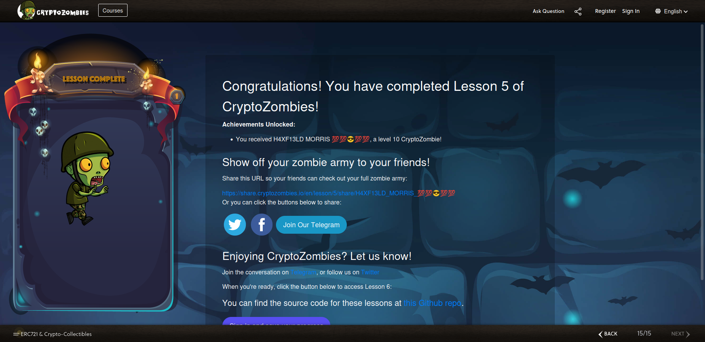
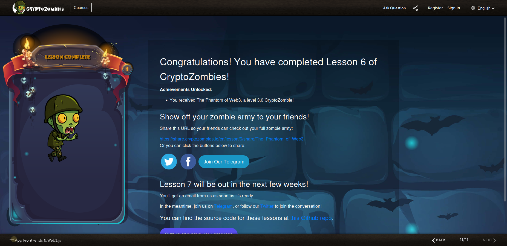
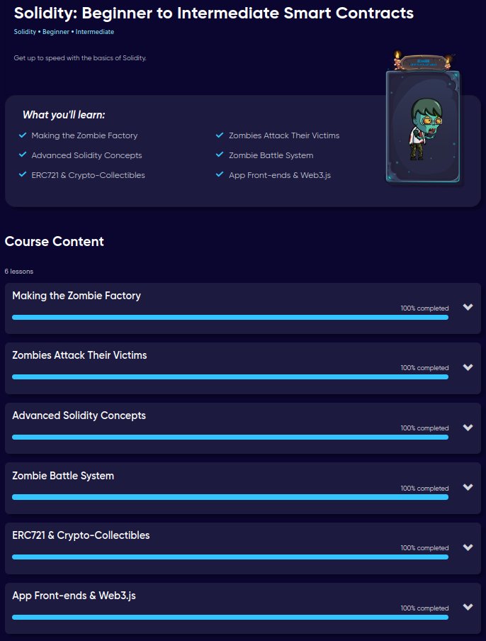
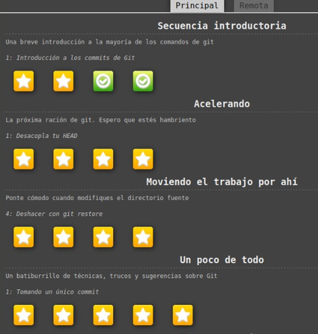
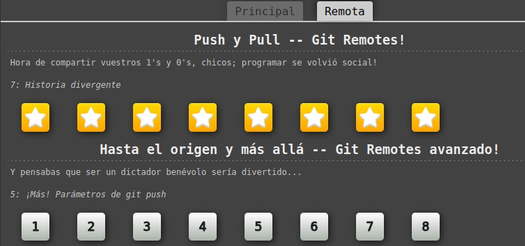

# ACT_UT1_4 · Solidity + Git

## 1. CryptoZombies

### 1. Lección 1

### 2. Lección 2

### 3. Lección 3

### 4. Lección 4

### 5. Lección 5

### 6. Lección 6

### Lecciones

## 2. LearnGitBranch

### 1

### 2

